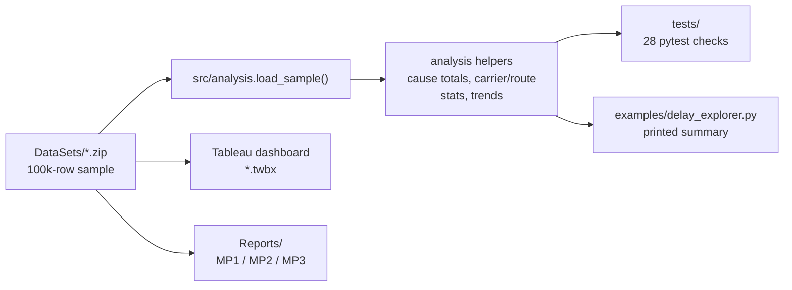

# U.S. Flight Delays & Cancellations Analysis

Data visualization project analyzing large-scale FAA flight-delay data.

## Overview
Analyzed U.S. flight delay and cancellation datasets with Python (Pandas, Seaborn,
Matplotlib) and built interactive Tableau dashboards ranking the most delay-prone
U.S. airports.

## Approach
- Data cleaning and wrangling of large FAA datasets (`DataSets/`)
- Statistical analysis to surface stakeholder-ready insights
- Interactive Tableau dashboard (`MP6 Pavan Kalyan Muniyappa.twbx`)
- Project reports: proposal, answerable questions, narrative (`Reports/`)

## Key findings (100k-row sample)
Computed from the bundled sample with `src/analysis.py` (`make demo` prints them):

- **On-time rate 81.5%** of operated flights arrived with under 15 minutes of delay; 2.6% of flights were cancelled.
- **Late-arriving aircraft is the biggest delay driver**: 445,653 delay minutes, ahead of carrier-caused delays (410,012) and NAS delays (231,360). Weather (67,379) and security (2,261) are minor by comparison.
- **Evening is the worst time to fly** (25.1% delayed) and morning the best (12.8%).
- **2020 was the quietest year** (9.7% delayed, but 6.0% cancelled) while 2023 was the most delayed (22.8%).
- **Busiest route HNL-OGG** (179 flights) is also one of the most reliable (11.9% delayed).

## Architecture


## Project structure
```
├── DataSets/   # sample dataset (CSV zip)
├── Reports/    # MP1 proposal, MP2 questions, MP3 narrative (PDF)
├── src/        # analysis.py: reusable delay-analysis helpers
├── tests/      # data-validation + analysis unit tests
├── examples/   # delay_explorer.py: runnable sample summary
├── Makefile    # setup / test / demo / clean shortcuts
└── *.twbx      # interactive Tableau dashboard
```

## How to run
```bash
pip install pandas numpy matplotlib seaborn jupyter
jupyter notebook   # explore the analysis
```
Open the `.twbx` file in Tableau Desktop for the interactive dashboard.

## Examples
Print the on-time summary, delay-cause breakdown, busiest routes, and
yearly trend for the bundled sample:

```bash
python examples/delay_explorer.py
# or: make demo
```

## Tests and CI
Data validation tests live in `tests/` and check the bundled 100k-row sample
(schema, year coverage, delay-cause consistency, route and time fields):

```bash
pip install -r requirements.txt
python -m pytest tests/ -q
```

`tests/test_analysis.py` adds 14 unit tests for `src/analysis.py` — synthetic
frames pin the arithmetic, and real-data checks assert values measured
against the sample (on-time rate 81.5%, cause totals, carrier/route stats,
yearly trend). 28 tests in total.

CI runs on every push and pull request to `main` (Python 3.11): it
byte-compiles the tests and runs the full suite.

## Make shortcuts
```bash
make setup   # install dependencies
make test    # run the pytest suite
make demo    # print the delay summary
make clean   # remove Python caches
```

## FAQ / troubleshooting
- **Why is `Season` always "Unknown"?** The bundled sample ships every row
  with `Season` set to `Unknown`, so season is not a usable grouping — the
  analysis uses `Year` and `TimeOfDay` instead.
- **Negative `DelayMinutes`?** Negative values mean the flight arrived
  early; `IsDelayed` is `DelayMinutes >= 15`, and the on-time rate counts
  operated flights under 15 minutes.
- **Cancelled flights have no `ArrDelay`.** Cancelled rows carry no arrival
  delay, so delay rates and mean delays are computed over operated
  (non-cancelled) flights only.
- **Keep the dataset zipped.** `src/analysis.py` and the tests read the CSV
  straight out of `DataSets/Pavan_Kalyan_MP4_Sample_100k.csv.zip` — do not
  extract it into the repo.
- **Tests fail on import?** Run from the repo root (`python -m pytest
  tests/ -q`); `tests/conftest.py` puts the repo root on `sys.path` so
  `import src.analysis` resolves.
